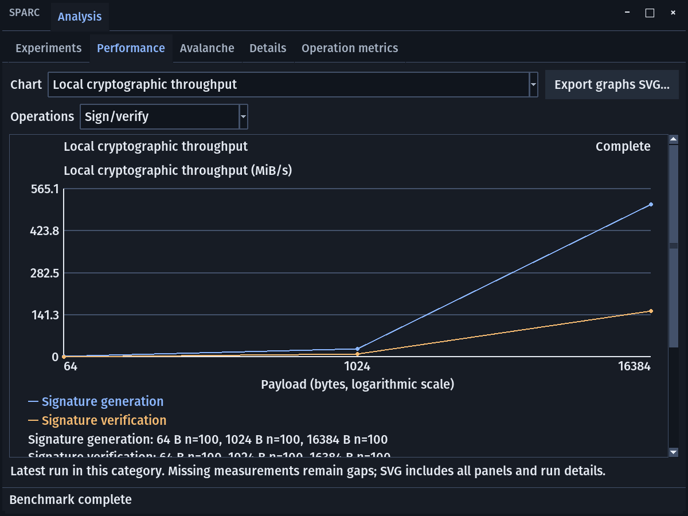
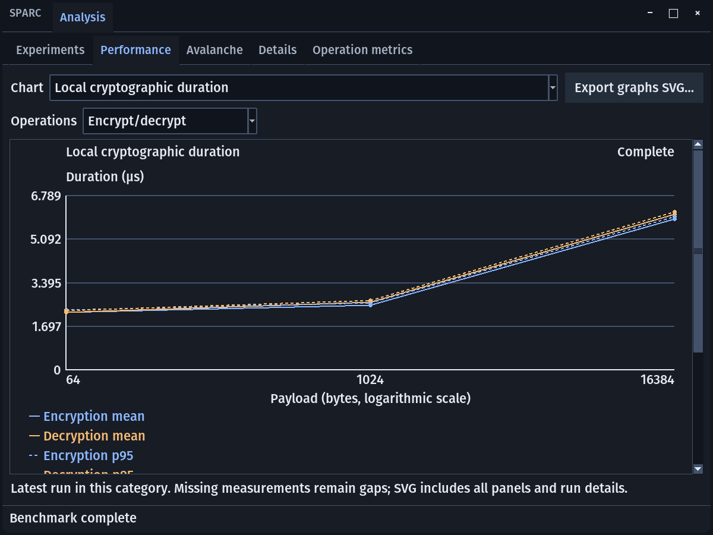
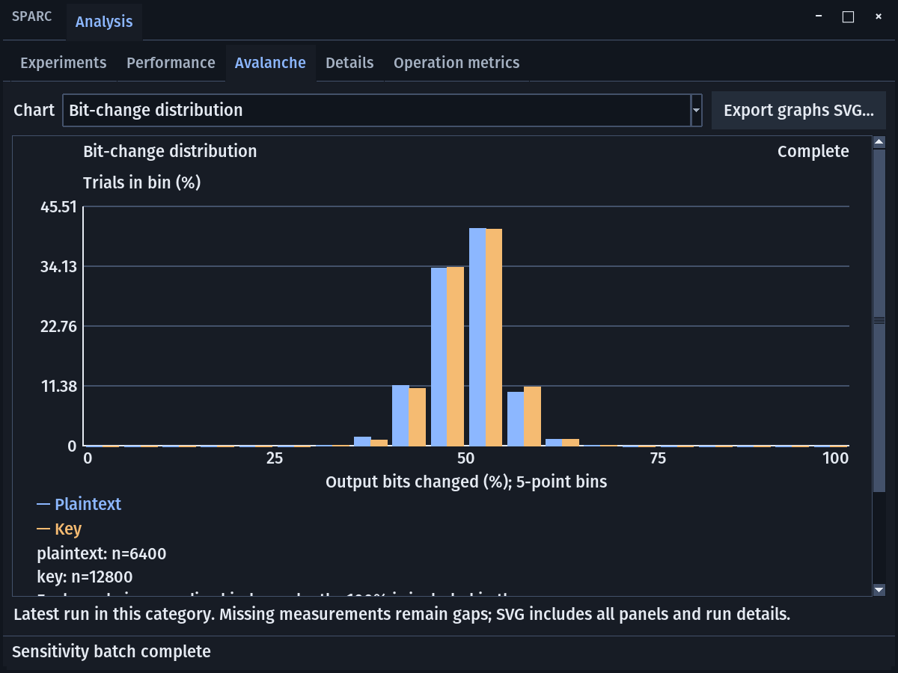
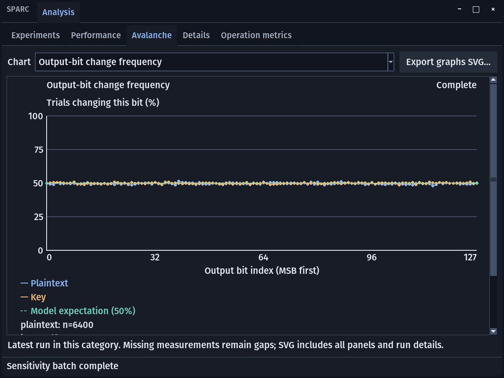
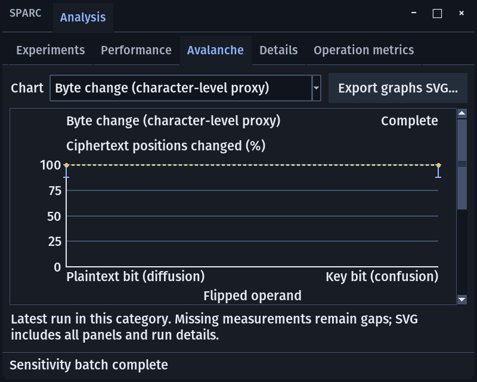

# Are the current graphs appropriate for the project?

**Historical audit of `ccc99ec`.** See the subsequent
[implementation and verification](../../analysis-presentation-evidence.md) for
the corrected graphs and current presentation workflow.

**Mostly yes: the principal chart families are appropriate, and the checked
numbers faithfully represent their measurements. Some graphs need better
presentation, and the signature byte-throughput graph is liable to mislead an
examiner about what was timed.** More graphs are not automatically better.

This follow-up audited the unchanged `ccc99ec` build on 2026-10-31. It adds
fresh native graph captures and numerical checks to the
[requirements audit](README.md).

## Chart-by-chart assessment

| Graph | Verdict | What it answers and what should change |
| --- | --- | --- |
| AES encrypt/decrypt duration versus payload size | Appropriate, improve context | Answers how measured AES-256-GCM call duration changes across workloads. Show algorithm, timing scope and exact values; use more sizes before claiming a scaling relationship. |
| AES encrypt/decrypt throughput versus payload size | Appropriate with a precise denominator label | Current numerator is application plaintext bytes, while the encrypted operand is a larger signed envelope. Label it effective plaintext throughput or separately report processed-envelope throughput. |
| SHA-256 hash/recomputation duration and throughput | Appropriate | These measure the same SHA-256 primitive on the same-size data in two timing passes. They are not different hashing algorithms or a security comparison. |
| Signature generation/verification duration | Appropriate | Use microseconds per operation; include median/spread as well as the existing mean/p95. Explain that this protocol signs a near-constant-sized context. |
| Signature generation/verification MiB/s | Misleading for a primitive-performance presentation | It divides original plaintext bytes by time spent signing/verifying a near-constant-sized context. Prefer signatures/s and verifications/s. If retained, name it effective associated-message throughput and explain its limited scope. |
| All operations on one duration chart | Optional overview, poor main presentation | Six means and six p95 series create twelve curves; signature verification compresses faster operations near zero. Use the existing operation-pair views or separate panels as the main presentation. |
| Single-trial bit/byte/hex percentage | Numerically valid, visually weak | One observation and its expectation appear as tiny nearby points in a large plot. Prefer a compact observed-versus-reference display with explicit changed/total counts and percentages. A reference line should span the plot even for a single category. |
| Batch mean and min–max for plaintext/key flips | Appropriate summary, insufficient alone | Shows average sensitivity and observed extremes. Min–max whiskers are not a confidence interval or a claim of typical spread; keep that label explicit. Pair with a distribution plot. |
| Bit-change histogram | Strong fit; keep | Shows the spread and shape across trials. Normalizing each mode independently is correct because the two modes have different trial counts. Add a clearly visible 50% reference and bin-boundary explanation. |
| Output-bit change frequency | Useful aggregate, with a scope limit | Shows whether each output bit changes near 50% after pooling all flipped input bits/cases. It does not establish the per-input-bit avalanche condition. A conditional input-bit × output-bit heatmap would answer that stronger question. |
| Byte/hex change versus reference | Correct values, difficult visual comparison | The 99.609375% model and 100% coursework reference nearly overlap on a 0–100 axis. Put exact values/counts beside the plot; preserve their distinct meanings. Hex changes use a different model, 93.75%. |
| Network duration and verified goodput | Appropriate | Useful application-level performance, including verified receipt time. Label loopback versus physical network evidence and distinguish it from local primitive timing. |
| PCAP graph | Not currently supplied; a conditional addition | The current table supplies aggregate captured bytes/s. If showing traffic variation is required, use captured bytes/s versus capture time with explicit bins. Keep it separate from verified plaintext goodput. |
| Graphs for the three hash-security properties | Not necessary to satisfy the science | A console/table with target/input, attempts, elapsed time and outcome is more informative than three identical zero-match bars. Search progress can be graphed, but it measures work, not a security score. |

## The most important correction: signature throughput

The fresh run produced signing means of approximately **35.93, 35.74 and
30.42 µs** at 64, 1,024 and 16,384 plaintext bytes. The associated signing
throughput curve nevertheless rises from **1.70 to 27.33 to 513.69 MiB/s**.

The arithmetic is consistent with the implementation:

`effective throughput = original plaintext bytes / measured signing time`

But the signed context stays approximately constant in length. The rising
curve mainly reflects a growing numerator; it does not demonstrate that the
Ed25519 primitive suddenly signs bulk data hundreds of times faster. The source
and chart footer acknowledge the context, but the headline “Local cryptographic
throughput” is too broad and the explanation sits below the first viewport.

Use **µs/signature**, **signatures/s**, **µs/verification**, and
**verifications/s** for the existing primitive benchmark. If measuring signing
arbitrary-length user messages is desired, that is a different experiment with
an explicitly defined signed input and timing boundary.

## Performance graphs: meaningful, but not evidence of a predetermined curve

The current **64, 1,024, 16,384** sizes are numerically spaced on a logarithmic
x-axis. That scale is valid and explicitly labeled. Their equal visual spacing
does not mean equal increments in bytes: both jumps multiply the size by 16.
An eye-catching bend on this axis is not evidence of nonlinearity on a linear
byte axis.

Your note “not directly proportional” should be a question the measurements
answer, not a shape imposed on the graph. Collect more workload sizes and
independent repeated runs before drawing a scaling conclusion. Keep measured
points prominent; connecting segments should only guide the eye, not imply a
fitted model.

Mean and p95 are useful, and the program correctly identifies p95 as a sample
percentile rather than a confidence interval. A box plot or distribution view
would expose timing variability that two summary curves hide. NIST's box-plot
description distinguishes median, quartiles, spread and outliers; this is a
recommendation for an additional view, not a claim that mean/p95 are invalid.
[NIST statistical handbook](https://www.itl.nist.gov/div898/handbook/eda/section3/boxplot.htm).

## Avalanche graphs: keep the histogram and qualify the aggregate frequency

The batch summary, normalized histogram and per-output-bit frequency serve
different purposes. Using them together is appropriate. The histogram is
particularly helpful for explaining why a single trial need not equal 50%.

The current frequency plot pools observations across different input-bit
positions. That averaging can conceal conditional biases. As a mathematical
counterexample, one input bit could always change alternating output bits and
another could always change the opposite bits: pooled output-bit frequencies
would all be exactly 50%, even though each input-bit/output-bit pair is strongly
biased. The audit verified that the current aggregate plot produces exactly
that pooled result for explicitly constructed hypothetical data. This is a
limitation of the statistic, not evidence of such a weakness in AES.

A conditional heatmap would be a stronger optional educational view: flipped
input bit on one axis, output bit on the other, and change frequency as the
cell value. It would still be finite experimental evidence, not a security
proof. With the current 50-case batch, each such cell would have 50 case
observations; the 6,400/12,800 pooled trial counts should not be presented as
that many independent observations for each pair.

For byte/character analysis, display the exact mean and a changed-byte count
alongside the graph. The idealized byte-change expectation and coursework
target are less than half a percentage point apart; their lines are visually
almost indistinguishable here. A labeled zoomed detail could help, but should
supplement the full percentage scale. Do not relabel hex changes as byte changes.

## Hash-security presentation

Keep full SHA-256 searches and their honest bounded outcomes. The relevant
questions are whether an input matching a target, a second input matching a
specified input, or any distinct matching pair was found. Those are the three
different properties in [NIST's definitions](https://csrc.nist.gov/projects/hash-functions).

Three bars labeled “100% secure” after zero matches would not represent what
the experiment establishes. A digest/inputs console plus attempts, elapsed
time, budget and clear result is appropriate. An attempts-versus-time plot,
if desired, would visualize search performance only. Digest equality for
received messages should remain visibly distinct from collision searching.

## Presentation changes to prioritize

1. Replace the signature byte-throughput headline with operation-based units.
2. Keep graphs, legends, units, sample counts and essential timing definitions
   visible together. The fresh 800×640 and 1200×900 captures both require
   scrolling for important legends/context; at 800×640 the byte chart's
   reference legend is entirely outside the initial viewport.
3. Use explicit algorithm names and timing boundaries. Separate pair views
   are clearer than the twelve-curve All operations view.
4. Put exact values/counts beside single-trial and near-100% byte graphs.
5. Add more workloads/repeated runs and an empirical spread view for a stronger
   performance evaluation; add a conditional avalanche view only if the
   presentation needs the stronger per-input-bit question.

The essential presentation set is: **AES time/throughput**, **SHA-256 time**,
**signature generation/verification time**, **plaintext/key bit-change summary**,
**bit-change histogram**, and **byte-level change with precise references**.
Network goodput and output-bit frequency are useful supporting views. Each
should state its measurement scope and whether it uses synthetic, loopback or
physical-network evidence.

## Evidence and limits

- Fresh native driver: `.demo/graph-audit/capture.py`; final exit 0; 15 captures
  and plot-series data in [graph observations](graphs/observations.json).
- Independent checks recalculated plotted means, p95, throughput, bit-change
  means and histogram normalization: **58 checks passed**, using 1,800 fresh
  timing samples and 19,200 sensitivity trials. The hypothetical pooling
  example is explicitly separated from actual AES observations in the
  [numerical verification](graphs/numeric-verification.json).
- `env PYTHONPATH=src .venv/bin/python -m pytest tests/unit/test_analysis_plots.py tests/unit/test_benchmark_stats.py -q --tb=short`
  — **27 passed in 0.10 seconds**.
- This validates the checked data transformations and identifies presentation
  limitations. It does not certify general benchmark reproducibility, formal
  cryptographic security, native macOS behavior or accessibility compliance.
- No application changes were made in this review.
