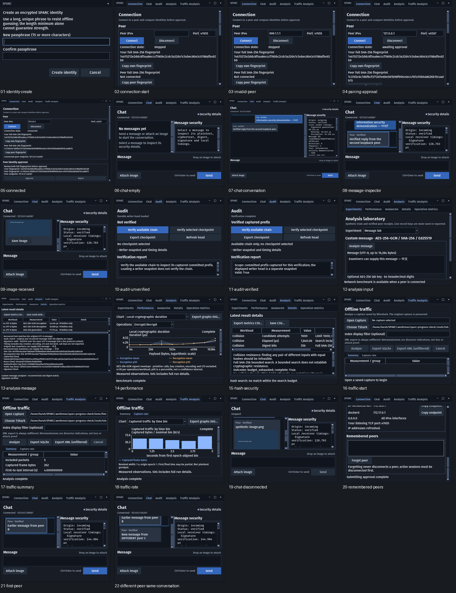

# Whole-app audit and next-change options

Audited build: `9962ba4`, `feat/sparc-progress-check`, Linux/X11, 2026-10-31.
This audit changes no application code. It evaluates the native experience,
workflow continuity, selected source boundaries and the regression suite. It is
not an independent cryptographic certification or a penetration test.

**Verdict:** SPARC has a working security laboratory and communication core.
Its largest remaining weakness is how people follow identities, experiments
and evidence across the application. Fix the concrete identity/connection issues
below, then choose a coherent major improvement rather than adding unrelated
algorithms or more graphs.

The user's intended outcome is an information-security project demonstration.
Recommendations therefore prioritize explaining and substantiating security
behavior while preserving manual IP configuration and existing native widgets.

## Fresh native walkthrough

The current run exercised real temporary encrypted identities, authenticated
loopback peers, Unicode text and image delivery, audit verification/checkpoint
export, custom-message analysis, nine-size local timing, full SHA-256 searching
and actual TShark capture decoding. No existing user identity was opened.

| Step | Screen / action | Health and observation |
| --- | --- | --- |
| 1 | [Create identity](screenshots/01-identity-create.png) | Clear masked fields and Cancel. Cancellation left no identity file. First-run project/demo orientation is absent. |
| 2 | [Connection start](screenshots/02-connection-start.png) | Manual peer configuration is clear. Listener/IP inventory requires scrolling at 800×640. |
| 3 | [Invalid peer IP](screenshots/03-invalid-peer.png) | Correctly rejected. The error is written below the visible viewport, so the visible form does not explain the failed action. |
| 4 | [First-contact approval](screenshots/04-pairing-approval.png) | Full fingerprints are available. Approve/Reject and the comparison instructions are below the compact viewport while the connection awaits approval. |
| 5 | [Connected peer](screenshots/05-connected.png) | Authenticated endpoint and fingerprints appear. Approval wording remains prominent after connection. |
| 6 | [Empty chat](screenshots/06-chat-empty.png) | Clear next action and disabled send state before connection. Security inspector starts open and consumes substantial compact-window space. |
| 7 | [Conversation](screenshots/07-chat-conversation.png) | Real bidirectional messages and verified delivery work. Sender labels are generic rather than identity-aware. |
| 8 | [Message inspector](screenshots/08-message-inspector.png) | Public timing/evidence is available. Important digest/signature fields require scrolling through a narrow text panel. |
| 9 | [Incoming image](screenshots/09-image-received.png) | Verified inline preview and explicit Save image are available. Receiving is automatic for the authenticated session; distinguish receiving from saving in documentation. |
| 10 | [Audit before verification](screenshots/10-audit-unverified.png) | Correctly distinguishes a loaded writer snapshot from verified records. |
| 11 | [Audit after verification](screenshots/11-audit-verified.png) | Correctly says captured prefix and no checkpoint selected. A novice still needs an explanation of what checkpoint comparison adds. |
| 12 | [Custom analysis input](screenshots/12-analysis-input.png) | Custom text is directly runnable. Key/help fields below the fold remain reachable by scrolling. |
| 13 | [Custom analysis output](screenshots/13-analysis-message.png) | Recovered text, matching digest, signature and primitive timings are visible together at wide size. |
| 14 | [Performance graph](screenshots/14-performance.png) | Nine workloads, operation grouping, legends, units and finite-sample scope work. |
| 15 | [Hash security](screenshots/15-hash-security.png) | Full SHA-256 search is honestly labeled inconclusive; console supplies the outcome rather than a fabricated security score. |
| 16 | [Traffic start](screenshots/16-traffic-start.png) | Offline source/tool/filter controls are explicit. The empty measurement table provides little guidance beyond opening a capture. |
| 17 | [Capture summary](screenshots/17-traffic-summary.png) | Real fixture decoded: five packets, 262 captured bytes. Captured traffic and application goodput have separate definitions. |
| 18 | [Capture rate](screenshots/18-traffic-rate.png) | Nominal bins and partial-edge scope remain visible. Return to Summary for source/filter controls. |
| 19 | [Disconnected chat](screenshots/19-chat-disconnected.png) | Sending is disabled and history stays visible. Messages need explicit historical identity/session context. |
| 20 | [Remembered peers](screenshots/20-remembered-peers.png) | List remains empty despite successful first-contact pairing during the run; source review identifies missing refresh on connection success. |
| 21 | [First peer in attribution check](screenshots/21-first-peer.png) | A real authenticated peer B sends a verified message. Its endpoint is the current Chat header. |
| 22 | [Different peer, same conversation](screenshots/22-different-peer-same-conversation.png) | After reconnecting to distinct peer C, B's earlier message remains beside C's message under C's endpoint, with both labeled Peer and no identity/session boundary. |

All 20 screenshots were inspected in the contact sheet; the compact approval,
invalid-IP, message-inspection and verified-audit screens were also inspected at
full resolution. [Structured current-run observations](observations.json).

## Findings in priority order

### P1 — Conversation identity and session provenance are missing

The Chat model keeps entries across disconnects while updating one current-peer
header. Text entries record origin, message ID and inspection, but no peer
fingerprint or session identity. Both service message-event branches omit those
fields too. Therefore reconnecting to a different peer can leave earlier
messages in the same conversation under a new endpoint header.

This is an attribution problem, not a demonstration that authentication fails.
The underlying signed audit evidence is a different, stronger source. Before
adding saved conversations or report exports, bind displayed messages to their
authenticated peer and session, and display a boundary or separate conversation
when that identity changes. Do not infer historical identity from the current
connection or endpoint alone.

Source: `gui/chat.py:_message`, `handle_event`, `_show_inspection`;
`peer/service.py` incoming/outgoing `ServiceEvent('message', ...)` branches.
The [fresh reconnect diagnostic](peer-provenance.json) confirmed the behavior
with two distinct authenticated fingerprints and endpoints. Both received
messages remain verified, but neither Chat entry retains a peer fingerprint or
session identifier. [Step 22](screenshots/22-different-peer-same-conversation.png)
shows the resulting ambiguity; this is not merely a hypothetical source concern.

### P1 — Critical connection feedback can be offscreen

Steps 3–4 show a failed IP input and an approval wait without their corresponding
error/action visible at 800×640. `_connect` places validation errors in
`_message_text`, whose label sits at the end of the long scrollable form.
`handle_event(pairing_request)` enables approval controls without revealing them.
The service's approval wait is bounded, making this more than cosmetic friction.

Place field errors beside the field or in a fixed visible status area. Reveal
the fingerprint comparison and approval actions when a request arrives, while
preserving deliberate approval and both full fingerprints. A guided connection
flow could then clarify listen/connect roles without removing manual IP input.

### P2 — Newly remembered peers do not refresh in the running GUI

Step 20 is empty. A separate fresh real-service check confirmed successful
pairing creates one trusted record on each peer. The GUI populates its list at
construction and after Forget, but the connected-state branch never refreshes
it. This can make a successful trust decision appear not to have been saved.

Refresh after successful pairing/connection or an explicit trust-change event;
test backend and visible list agreement without requiring an app restart.
The additional native diagnostic measured **two backend trusted records and
zero visible records**, with no callback error. See its
[numeric record](peer-provenance.json). The additional trust-list screenshot
was rejected because its scroll position did not show the list; step 20 is the
accepted visual evidence, paired with these runtime measurements.

### P2 — Results are fragmented and short-lived

Analysis has one current `_last_result`; chat keeps bounded in-memory history.
Benchmarks have run IDs and capture indexes have source hashes, but the GUI has
no named project experiment tying message evidence, audit checkpoints, graphs,
hash searches and capture provenance together. Running a later experiment
changes what Details exports, and an application restart does not restore a
collected experiment workspace.

This is a product gap rather than a promise that every message should be saved.
An explicit experiment session could collect selected public artifacts, retain
their units/scope and generate a requirements-to-evidence report. Separate
measured, unmeasured and imported/self-reported values; preserve the originals.
Decide plaintext retention deliberately rather than silently persisting chat.

### P2 — Important failure demonstrations are hidden in tests and recipes

The source and tests include GCM tamper rejection, sequence/replay rejection,
invalid signature/hash handling and retained-checkpoint tail checks. The GUI
mainly shows successful messages, passive verification and finite hash searches.
For a project examiner, those are different questions: observing no SHA-256
collision in 1,000 attempts does not show what happens when a protected message
is altered or replayed.

An isolated security demonstration lab could expose real controlled failures,
show the changed bytes, expected rule, observed rejection and what the result
does or does not establish. It should use disposable synthetic sessions/copies
and the actual codecs/verifier, with no switches disabling live protections.

Source examples: `tests/unit/test_records.py::test_replay_is_rejected`,
`test_wire_tamper_fails_closed`, `test_independently_encrypted_invalid_envelopes_fail_closed`;
`tests/unit/test_audit_verify.py::test_chain_only_cannot_assert_tail_absence`;
the existing copy-only procedure in `docs/progress-check-demo.md`.

### P2 — Signature artifact save/load bounds disagree

Fresh reproduction: saving a `SignatureResult` with 65,537 signed bytes succeeds
and creates a 131,569-byte JSON file. Loading that same file rejects
`signed_bytes`, because the loader accepts at most 65,536 signed bytes while
the serializer only checks the larger total-artifact size. Editable GUI fields
can create such a result; the verification helper itself has no input-size cap.

Use one signature-artifact field contract at creation/save/load boundaries.
Preserve the previous file on invalid saves. Keep legitimate edited/invalid
signature demonstrations supported within the documented limits.

## Strengths to preserve

- Manual IP setup, first-contact fingerprint approval, encrypted local identity
  and independent audit verification are concrete functioning features.
- Public inspection and measurement scope are unusually explicit for a student
  project. The latest Analysis work fixes misleading signature byte rates and
  distinguishes coursework targets from statistical models.
- The audit screen accurately distinguishes a loaded head, a verified captured
  prefix and checkpoint comparison; it does not claim all future records or a
  missing tail are verified.
- Actual text/image delivery, hashes, signatures, bounded work and capture
  decoding are exercised by tests and the fresh native walkthrough.
- Shared native styling and operation-pair graphs are coherent. A platform
  rewrite would add migration work without addressing the main evidence gaps.

## Brainstorming: three major directions

These are proposals for the user's choice, not an approved design or an
implementation plan. The small confirmed defects above should be corrected
regardless of which direction is selected.

| Direction | Concrete experience | Main benefit | Tradeoff |
| --- | --- | --- | --- |
| **A. Guided security demonstration lab — recommended for the presentation** | Choose ciphertext/tag tampering, replay, wrong signature or audit-tail removal. Inspect original/modified synthetic evidence and watch the real verifier accept or reject it. Export the outcome with its limits. | Makes security behavior visible and explainable, extending the GUI beyond successful encryption and timing charts. | Needs carefully isolated fixtures, reliable expected outcomes and clear distinctions between detection layers. It does not replace live LAN evidence or prove cryptographic strength. |
| **B. Experiment sessions and report builder** | Name a project run; collect selected measurements, graphs, checkpoints and capture metadata; revisit/compare runs and export one structured report. | Best improvement for repeatability, submission evidence and keeping a demonstration organized. | Requires a versioned workspace/artifact model and explicit decisions about what message content is retained. Report exports must distinguish reported metadata from verified evidence. |
| **C. Peer workspace and guided connection** | Pair through visible steps, assign local peer labels, reopen a peer's own conversation, see identity/session boundaries and reconnect using saved endpoints. | Best improvement for routine messaging and reduces the current connection/attribution friction. | Persistent history brings storage/privacy design choices; it adds less new security-analysis content for the examiner than A. |

Given the existing academic goal, **A offers the strongest new demonstration**.
Choose B first if the main pain is assembling the final report rather than
explaining security live; choose C if SPARC's primary goal is shifting toward
daily use. Combining all three into the next milestone would obscure scope.

A sensible initial A scope is four demonstrations: authenticated-ciphertext
tampering, replay, invalid signature inside an otherwise authenticated record,
and tail removal with/without an independently retained checkpoint. Each needs
an explicit untouched control, expected outcome, actual result and limitations.
These are independent proposed acceptance ideas, not claims that such a GUI
already exists.

The recommendation is grounded in this app's captured behavior. As external
method guidance, [NIST SP 800-115](https://csrc.nist.gov/pubs/sp/800/115/final)
describes planning technical security tests, analyzing findings and reporting
their limits. This is methodological support, not NIST endorsement or a claim
that this audit satisfies a formal assessment standard.

## Verification and limits

Native run: 20 screens, zero Tk callback errors; a valid custom message/digest/
signature; 1,620 local timing samples across nine workloads; five decoded
capture packets totaling 262 bytes. Source inspection covered GUI lifecycle,
service message provenance/trust snapshots, record gates, artifact bounds,
measurement exports, checkpoint presentation and identity startup.

Fresh full regression, using `DISPLAY=:1` and the real synthetic decoder:
**1,273 passed, 9 skipped in 223.81 s**. Skips require native Windows semantics.
Dependency check reports no broken requirements. The two additional conversation
screens were inspected at full resolution, making **22 accepted screens** in
total. Both native drivers recorded zero callback errors. Application code
remains unchanged; passing tests do not invalidate the newly reproduced gaps.

Not validated: physical LAN behavior, native macOS/Windows UI, screen readers,
complete keyboard-only traversal, formal color-contrast conformance, external
penetration testing or a comprehensive dependency-vulnerability assessment.
Source/UI observations and test results are kept distinct from those claims.
